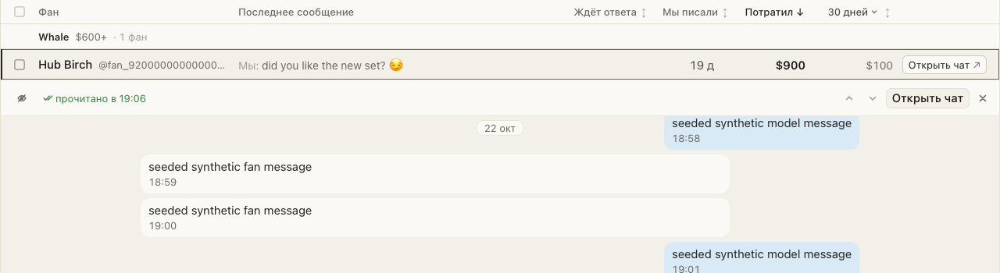

# Видно, прочитал ли фан ваше последнее сообщение

В переписке фана под строкой Spenders стоит пометка: «не прочитано» или «прочитано в 19:06». Так сразу
понятно, ждать ответа или напомнить о себе.

## Как это устроено

На Fansly пометку даёт сам Fansly. На ChatSpace расширение читает историю чата, только когда ваше
сообщение в нём последнее и непрочитанного от фана нет: чтение истории отмечает чат прочитанным, и так
ни одно новое сообщение фана не станет прочитанным незаметно для вас.
