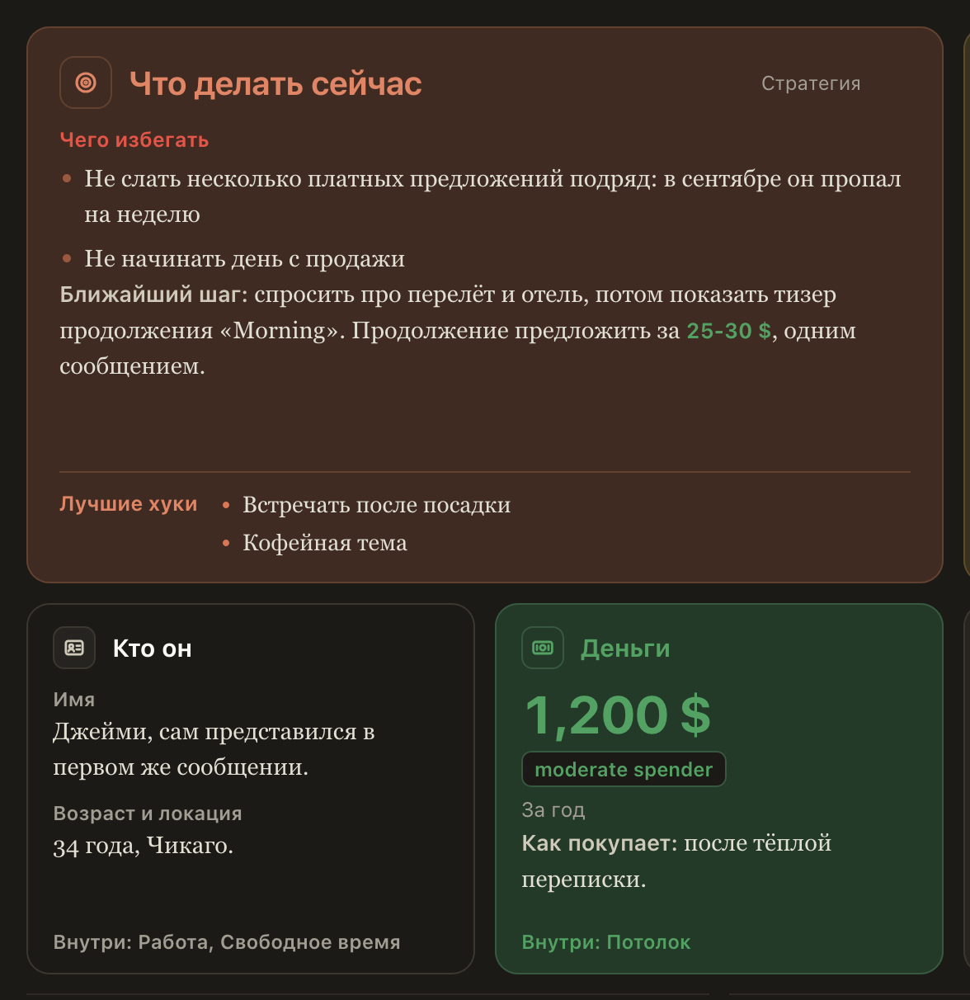

# «Сводка» Recap не выдаёт «Чего избегать» за совет, а сумма трат видна целиком

Если в «Стратегии» Recap не было пункта «Рекомендуемый подход», «Сводка» ставила крупно под «Что делать сейчас»
первую строку из «Чего избегать», без подписи и без красного цвета, а «Шпаргалка» могла показать её в «Дальше».
Совет читался наоборот. Теперь крупно стоит только подход (у короткого Recap «Следующий ход»). Если подхода нет,
крупной строки нет: пункты идут как в Recap, «Чего избегать» со своей подписью и красным, а в «Дальше» запретов не бывает.

И сумма в «Деньгах» бралась с середины числа: «всего 1,200 $ за год» превращалось в «200 $», «10-20 $» в «20 $».
Теперь сумма видна целиком, а если её нельзя прочесть однозначно, крупной суммы нет и остаётся текст.

## Как это устроено

«Что делать сейчас» берёт крупную строку только из пункта, который Recap подписал как подход («Рекомендуемый
подход» и похожие), или из «Следующего хода» короткого Recap, и никогда из «Чего избегать». «Дальше» в «Шпаргалке»
берёт «Рекомендуемый подход», а без него последний пункт «Стратегии», который не «Чего избегать».

Сумма в «Деньгах» и зелёная подсветка сумм в тексте начинаются там, где начинается число: «1,200 $», «1 200 $»,
«81,97 $», «10-20 $», «$25-30», «$10 - $20», «$1.5k». На графике по месяцам «ноль» относится только к месяцам своей
части фразы: в «В июне $50, в июле ноль, в сентябре 30 $» пустой только июль, а июнь, записанный как «$50», на
график не попадает, а не рисуется нулём.
