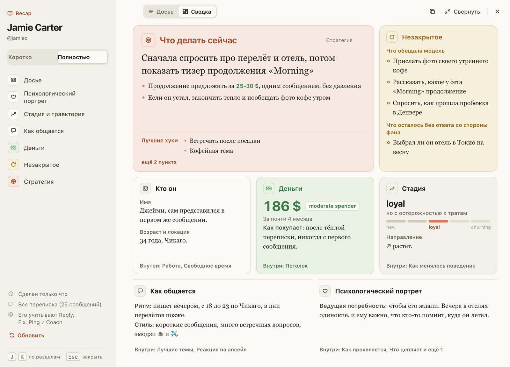

# В окне Recap появилась «Сводка»: главное о фане на одном экране

Вверху окна Recap теперь переключатель «Досье | Сводка». «Сводка» раскладывает Recap плитками на одном экране:
крупно «Что делать сейчас» и лучшие хуки, рядом «Незакрытое» (что обещала модель и что осталось без ответа), ниже
«Кто он», «Деньги» с суммой и классом трат, «Стадия» на шкале и её направление, «Как общается» и «Портрет».

В плитке только целые пункты, а что не поместилось, перечислено внизу: «Внутри: …» или «ещё N пунктов». Нажмите
плитку, и её раздел откроется целиком в «Досье». Пока вкладка открыта, окно открывается в том виде, который вы выбрали.

## Как это устроено

Плитки собираются из тех же разделов Recap, что и «Досье». «Что делать сейчас» берёт «Рекомендуемый подход» из
«Стратегии» (у короткого Recap «Следующий ход»), его первая строка набрана крупно. Плитка показывает столько целых
строк, сколько помещается, и не режет предложения. Сумма, класс трат, суммы по месяцам и направление тренда берутся
из текста раздела «Деньги», шаг и направление стадии из «Стадии и траектории»; если хаб написал иначе, остаётся текст.
Recap в другом формате показывается простой сеткой разделов.
