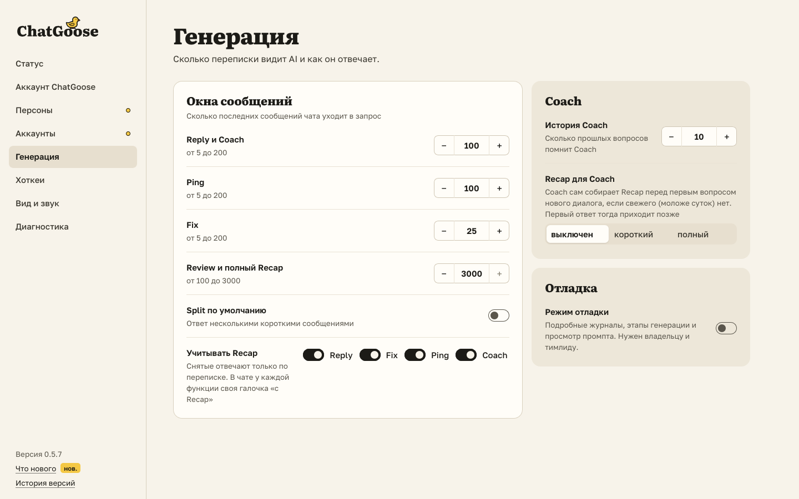
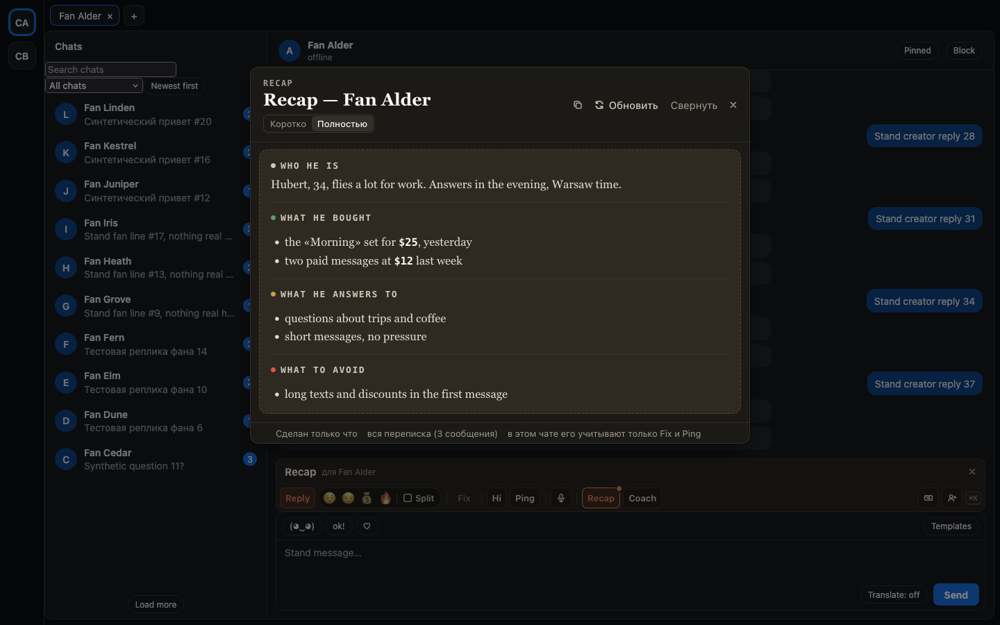

# У каждой функции своя галочка «с Recap»

Recap теперь включается и выключается отдельно для Reply, Fix, Ping и Coach. Например, Ping можно оставить без Recap,
а Reply с ним.

- В настройках («Генерация» → «Учитывать Recap») есть четыре галочки: Reply, Fix, Ping и Coach. Снятая функция по
  умолчанию отвечает только по переписке.
- В чате галочка «с Recap» в заголовке ответа меняет только эту функцию: если снять её у Reply, то Ping, Fix и Coach его
  по-прежнему учитывают. «Учитывать Recap» вверху Coach действует только на Coach.
- Recap пишет, кто его учитывает в этом чате: «в этом чате его учитывают только Fix и Ping».

## Как это устроено

Галочки своего чата живут, пока открыта вкладка; новая вкладка берёт их из настройки. Если раньше в настройках
была снята общая «Учитывать Recap», все четыре галочки начинаются снятыми. Сборка Recap галочки больше не ставит:
что включено, решаете вы. Hi, Review и Voice Recap не читают, поэтому галочек у них нет.
