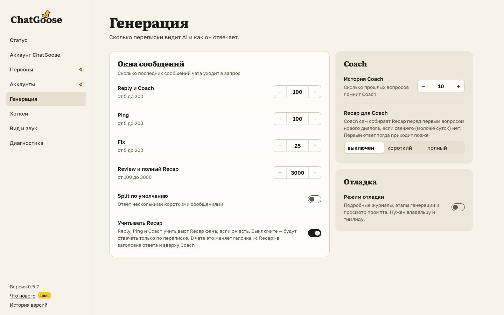

# Галочка «с Recap»: ответ с Recap фана или без

Теперь вы сами решаете, учитывает ли AI Recap фана: например, если Recap устарел или уводит ответ не туда.

- У Reply и Ping в заголовке ответа есть галочка «с Recap · 3 д назад». Снимите её, и ответ пересоберётся без Recap, а
  дальше Reply, Ping и Coach в этом чате ответят только по переписке. Поставьте, и он пересоберётся с Recap.
- В Coach вверху та же галочка называется «Учитывать Recap». Если снять её в одном месте, она снимется и в другом.
- Ответ Coach без Recap подписан «без Recap: выключен».
- В настройках («Генерация») есть «Учитывать Recap»: с чего начинается галочка в каждом чате. После перезагрузки страницы
  галочка возвращается к настройке, а когда вы собираете Recap, ставится сама.

## Как это устроено

Галочка своя у каждого чата и живёт, пока открыта вкладка; новая вкладка берёт её из настройки «Учитывать Recap». Когда она снята, расширение передаёт хабу «без
Recap». Хаб не кладёт в запрос ни досье фана (для Reply и Ping), ни полный и короткий Recap (для Coach) и отвечает,
что Recap не было. По этому ответу и ставится подпись. Авто-Recap перед первым вопросом Coach при снятой галочке
не собирается. Хаб, который не знает «без Recap», галочку не показывает. Общая настройка владельца (какие функции
вообще читают досье) осталась в хабе.
