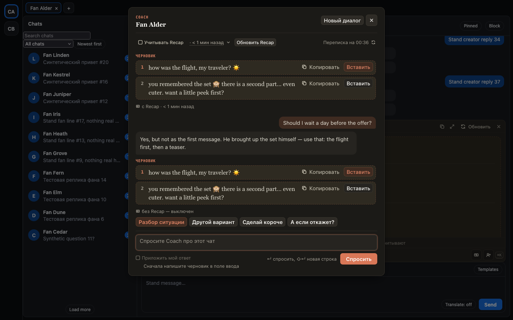
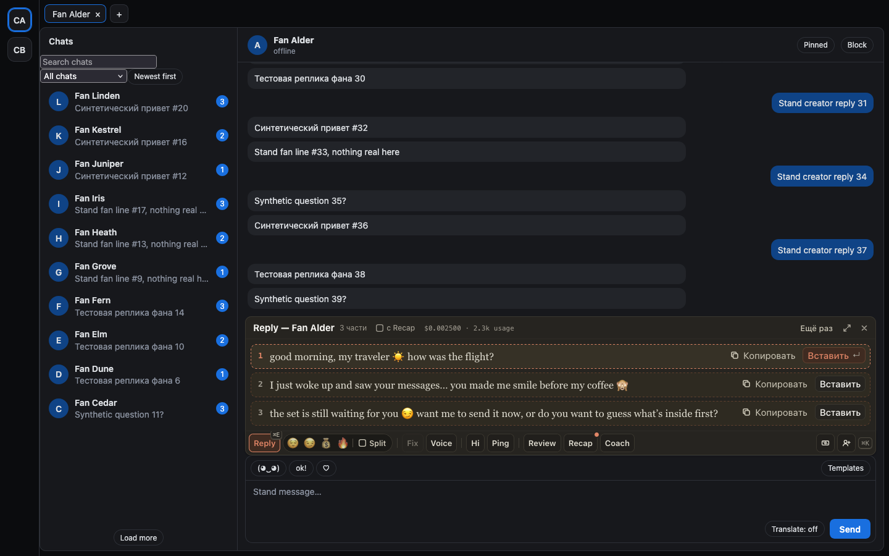

# Галочка «с Recap»: ответ с Recap фана или без

Теперь вы сами решаете, учитывает ли AI Recap фана. Это нужно, если Recap устарел или уводит ответ не туда, а
обновлять его сейчас не хочется.

- У Reply и Ping в заголовке ответа — галочка «с Recap · 3 д назад», если ответ учёл Recap. Снимите её — ответ
  пересоберётся без Recap, и дальше Reply, Ping и Coach в этом чате будут отвечать только по переписке. Поставьте
  обратно — ответ пересоберётся с Recap.
- В окне Coach вверху та же галочка — «Учитывать Recap». Это одна и та же настройка: сняли в одном месте — снята и
  в другом.
- Ответ Coach без Recap подписан «без Recap — выключен», у Reply и Ping галочка в заголовке снята. В самом Recap
  написано, что в этом чате он выключен.
- Галочка возвращается сама, когда вы собираете или обновляете Recap, и после перезагрузки страницы — как Split.

## Как это устроено

Галочка своя у каждого чата и живёт, пока открыта вкладка. Когда она снята, расширение передаёт хабу «без
Recap». Хаб не кладёт в запрос ни досье фана (для Reply и Ping), ни полный и короткий Recap (для Coach) и отвечает,
что Recap не было. По этому ответу и ставится подпись. Авто-Recap перед первым вопросом Coach при снятой галочке
не собирается. Хаб, который не знает «без Recap», галочку не показывает. Общая настройка владельца — какие функции
вообще читают досье — осталась в хабе.
