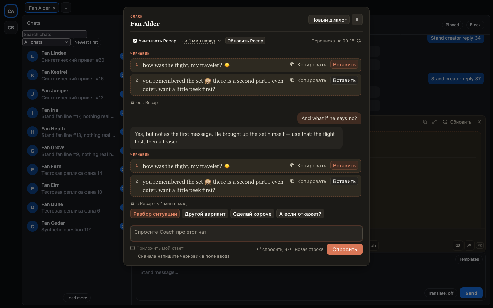
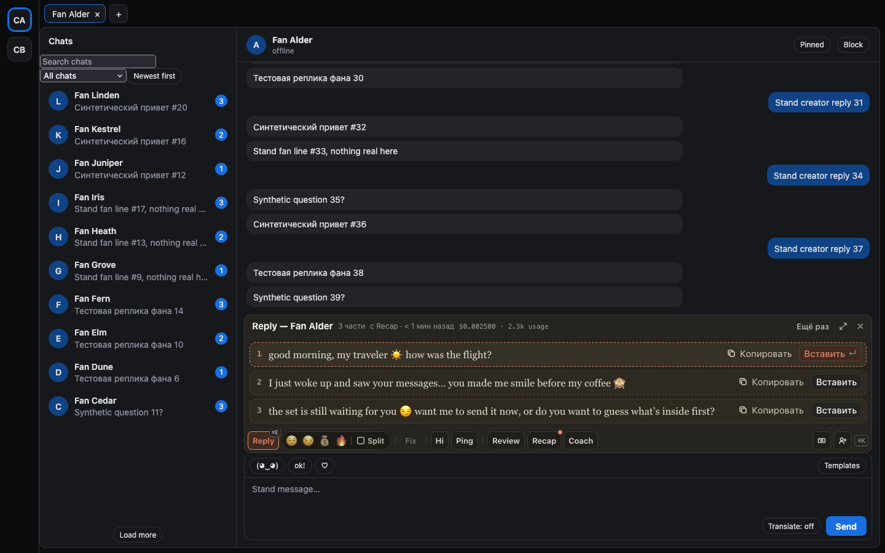

# Видно, учёл ли ответ Recap фана

Раньше было непонятно, доходит ли до AI уже собранный Recap фана. Теперь это написано там, где вы смотрите
на ответ:

- Под каждым ответом Coach стоит «с Recap · 3 д назад» или «без Recap».
- У Reply и Ping рядом с числом частей появляется «с Recap · 3 д назад», если ответ его учёл.
- Вверху окна Coach видно «Учитывать Recap · 3 д назад» (нажмите на время, чтобы прочитать) или «Recap нет: Coach
  видит только последние 100 сообщений». Рядом одна кнопка: «Собрать Recap» или «Обновить Recap».
- В самом Recap написано, кто его учитывает: полный учитывают Reply, Ping и Coach, а короткий только Coach. Под
  кнопками сборки объяснено, чем полный отличается от короткого.

Меню «Recap ▾» в Coach убрано. «Новый диалог» теперь рядом с крестиком.

## Как это устроено

Метки под ответами не догадка: вместе с ответом хаб сообщает, какие Recap он положил в запрос. Coach получает
полный Recap фана для этой персоны и короткий, если тот новее полного. Reply и Ping получают досье фана: последний
сохранённый полный Recap, без портрета и стратегии. Если хаб ничего не сообщил, метки нет. Строка вверху Coach показывает
то, что Coach получит со следующим вопросом. Полный Recap собирается около полутора минут, потому что читает всю
переписку. Авто-Recap перед первым вопросом остался в настройках, по умолчанию выключен.
