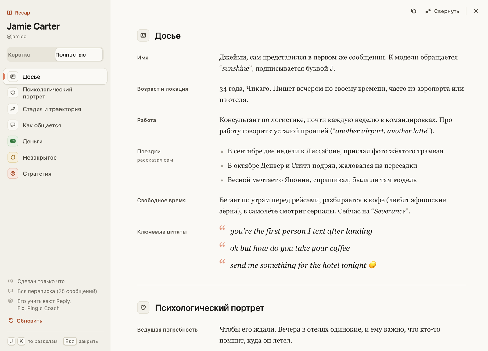
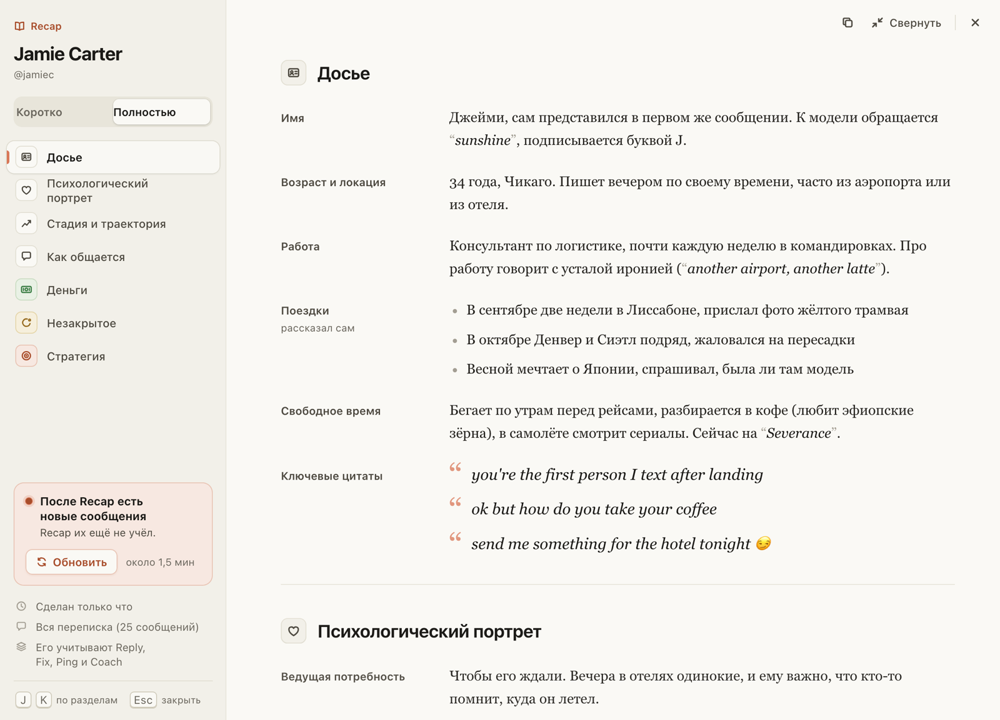
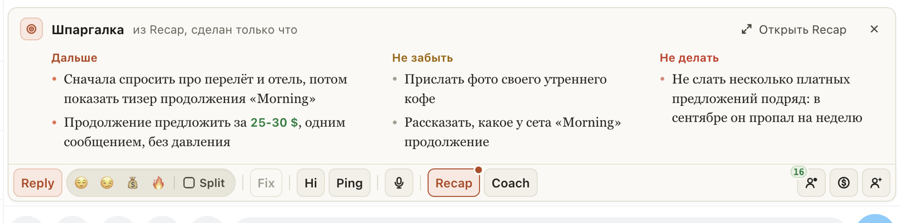

# Recap открывается большим окном: разделы слева, текст по полям справа

Раньше Recap открывался полоской над панелью, где почти ничего не помещалось, а в окне заголовки терялись в тексте.
Теперь кнопка Recap (и ⌘⇧S) сразу открывает большое окно. Слева имя фана, «Коротко | Полностью» и разделы: Досье,
Психологический портрет, Стадия, Как общается, Деньги, Незакрытое, Стратегия. Нажмите раздел или его цифру, J и K
листают по порядку. Справа подписи вроде «Имя» и «Работа» стоят своей колонкой, история по месяцам идёт лентой,
слова фана набраны цитатами, стадия и траты показаны на шкале.

Если Recap ещё не сделан, окно предлагает собрать полный или короткий. Если после Recap в чате были новые
сообщения, слева видно «После Recap…» и кнопку «Обновить». Пока собирается новый, прежний остаётся на экране.

«Свернуть» превращает окно в шпаргалку над панелью: что делать дальше, что не забыть, чего не делать.

## Как это устроено

Текст Recap тот же, что пишет хаб: расширение только раскладывает его по разделам, подписям, спискам и датам.
Если формулировки другие и разобрать их не выходит, текст показывается как есть. Шкалы стадии и трат и крупная
сумма берутся из тех же строк («Текущая стадия», «Классификация»). Шпаргалку собирают «Рекомендуемый подход»,
«Что обещала модель» и «Чего избегать» (у короткого Recap: «Следующий ход», «Открытые нити», «Границы»).

Во время сборки разделы слева загораются по мере того, как хаб их пишет; первый Recap появляется в окне по разделу.
«Обновить» и ⌘⇧S в открытом окне собирают Recap заново, это платный запуск, как и раньше. В шпаргалке ⌘⇧S только
открывает окно. Клавиши разделов работают, пока открыто окно; вне его J и K по-прежнему листают чаты.
