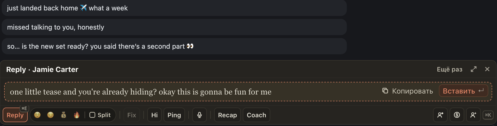

# Reply, Fix и Hi больше не показывают заметки ИИ вместо ответа

Иногда в ответе Reply, Fix или Hi вместе с сообщением фану оказывались черновые заметки ИИ на английском:
варианты («Something like: …», «Maybe: …»), проверки правил вслух («Hmm, … is banned. Fix.», «Wait: … Remove.»)
или служебные метки вроде `</budget:thinking>`, `<reply>`, ` `. Их приходилось вычищать руками перед отправкой.

Теперь такие заметки и метки убираются, в ответе остаётся только сообщение фану. Если ИИ переписывал черновик
несколько раз, в Split иногда остаются два похожих варианта одной части: оставьте тот, что нравится.

## Как это устроено

ИИ иногда пишет свои рассуждения прямо в текст ответа. Расширение и раньше вырезало блоки `<thinking>` и строки
с проверкой правил, теперь оно узнаёт ещё:

- метки с приставкой (`<budget:thinking>`, `<analyzing>`) и закрывающую метку без открывающей: всё до неё считается рассуждением;
- обёртки вокруг ответа (`<reply>`, ` `, вызов инструмента, записанный текстом): их убирает, текст внутри оставляет;
- проверку правил вслух: «restates», «invented fact», «is banned», «last three messages», «ends with no period», черновик под меткой «Something like:», чтение фана в третьем лице с указанием самому себе.

Правила проверены на 36 761 ответе с 25 сентября по 30 октября: ни один обычный ответ не изменился, рассуждения
пропали из 51 ответа из 61, где они были видны.
