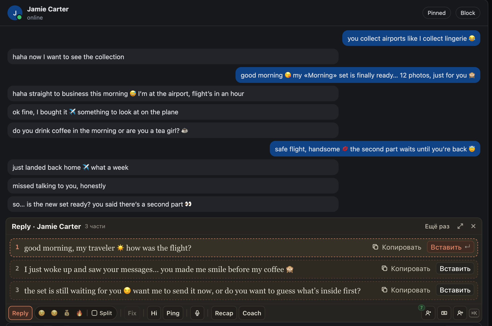

# Reply в нескольких чатах сразу: переход в другой чат больше не обрывает ответ

Нажали Reply, сразу перешли в следующий чат, а ответ в первом так и не появился. Так бывало на OnlyFans: первые
секунды после нажатия ChatGoose ещё читает открытый чат и фото фана, и переход в другой чат в этот момент молча
отменял Reply. Теперь ответ пишется для того чата, где вы нажали, и ждёт вас там. Можно нажать Reply в одном чате,
перейти в следующий и нажать там. Одновременно идут до трёх ответов, про четвёртый ChatGoose скажет сразу.

В «Онлайн» так же: Reply, Hi и Ping у нескольких фанов подряд пишутся одновременно. Раньше четвёртый фан подряд мог
остаться без текста без объяснений. Теперь, если уже идут три ответа, карточка так и пишет, а кнопка пишет снова.

## Как это устроено

Перед запросом к AI ChatGoose собирает открытый чат: последние сообщения, платные сообщения и фото из последнего
сообщения фана. На OnlyFans это до 1,2 с на чтение чата и до 2 с на фото. После сбора стояла проверка «чат сменился»,
и запрос, собранный для прежнего чата, отбрасывался без следа: до AI он не доходил. Теперь он уходит для чата, где
был клик. Всё читается по этому чату, и ответ ждёт в его доке, как и раньше при переходе после старта.

В «Онлайн» каждое нажатие теперь стартует сразу, а не ждёт очереди из двух. Разрешение клика живёт секунды, и текст,
дождавшийся очереди, уже не начинался. На вкладке по-прежнему идут не больше трёх ответов: четвёртый не запускается
сам, карточка пишет об этом, Reply можно нажать снова, когда один закончится.
