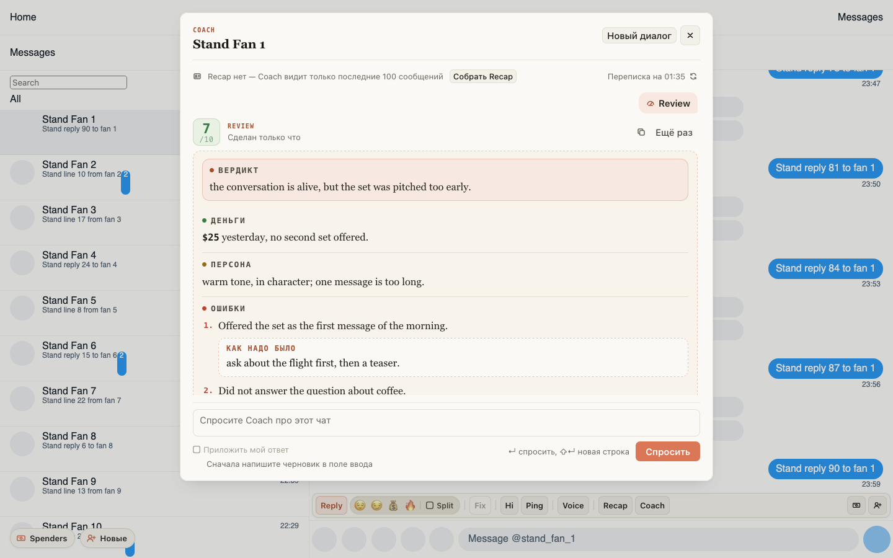
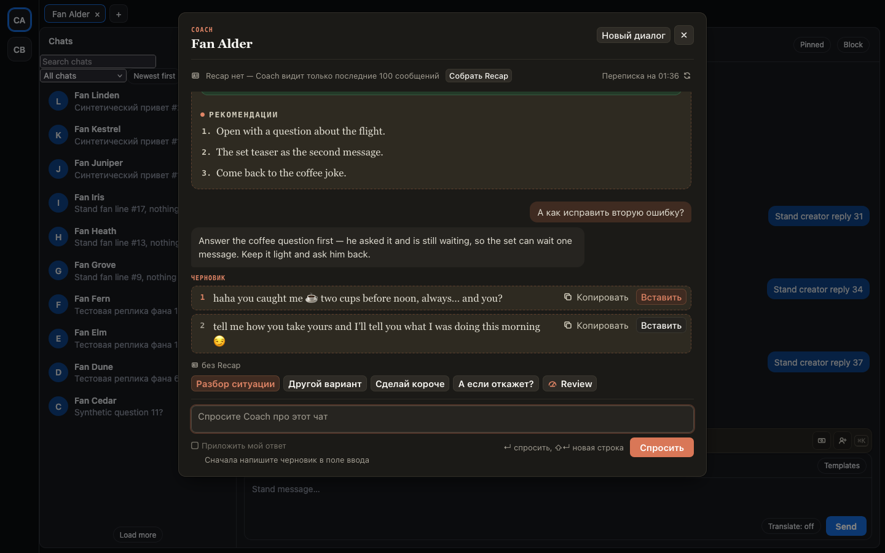

# Review — внутри Coach, а полоса над полем стала короче

Отдельной кнопки Review в полосе над полем больше нет: Review теперь внутри Coach. Откройте Coach и нажмите
«Review» рядом с готовыми вопросами — или ⌘⇧B (Ctrl+Alt+B), Coach откроется сам. Оценка вашей работы в этом чате
встанет в диалог ответом: балл, вердикт, деньги, персона, ошибки с «Как надо было», что сработало и рекомендации,
с «Копировать» и «Ещё раз».

Coach видит этот Review. Сразу после него можно спросить «а как исправить вторую ошибку?» — и получить совет с
готовым черновиком. «Новый диалог» начинает с чистого листа, вместе с Review. Само окно Coach стало шире: Review и
черновикам просторнее, а строки совета остались прежней длины.

Полоса стала короче: Reply с тонами │ Fix │ Hi, Ping │ Voice │ Recap, Coach. Voice стоит сразу после Ping, за
перегородкой. На узком поле ввода кнопки дольше остаются словами, а полоса реже уезжает вбок.

## Как это устроено

Review — та же функция хаба, что и раньше: тот же переключатель владельца, те же условия (в чате хотя бы 30
сообщений) и тот же дневной лимит. Если Review сейчас недоступен, кнопка «Review» в Coach серая, а в подсказке
написано почему — как раньше у кнопки в полосе. Если на странице выключен Coach, но включён Review, кнопка Coach
всё равно открывает окно: в нём только «Review».

С каждым следующим вопросом Coach получает Review в истории диалога текстом: «Review» как вопрос и вся оценка как
ответ — балл, блоки, «Как надо было», рекомендации. Длинную оценку история сокращает так же, как длинный ответ
Coach. «Ещё раз» и повторное «Review» в том же диалоге оценивают чат заново. Диалог Coach вместе с его Review
живёт, пока открыта вкладка.
