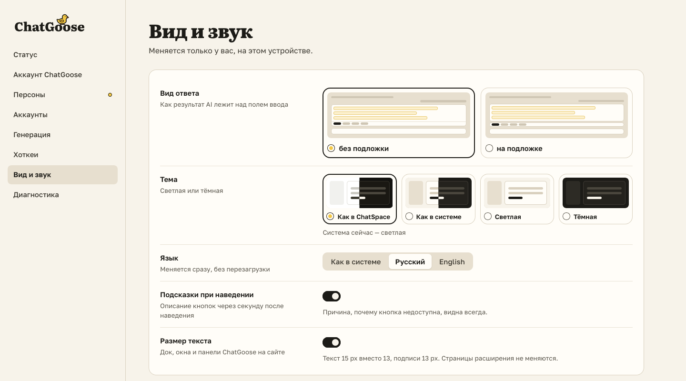

# Все настройки — на одной странице

Для чаттеров Fansly. Кнопка «Настройки» в окне ChatGoose открывает страницу со всеми разделами: статус,
аккаунт ChatGoose, персоны страниц, аккаунты, генерация, хоткеи, вид и звук, диагностика. Тема — как у
сайта, как в системе, светлая или тёмная. Текст панели крупнее — одним переключателем.

Если что-то не работает, начните со «Статуса»: там видно, всё ли на связи, и есть кнопка «Скопировать
отчёт для тимлида».

## Как это устроено

Настройки хранятся в этом браузере и действуют на обоих сайтах. Каталог персон ведёт тимлид в хабе, а
здесь вы выбираете персону для своих страниц. «Статус» проверяет связь с хабом и сайтом каждый раз, когда
вы открываете страницу, и по кнопке «Проверить всё».
