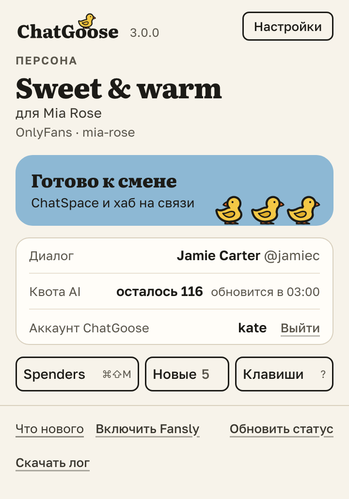

# «Скачать лог»: если кнопка не сработала, отправьте файл тимлиду

Кнопка не нажимается, Hi не отправляется, ответ не вставляется — нажмите значок ChatGoose на панели Firefox,
внизу окна — «Скачать лог», и отправьте файл тимлиду. По нему видно, что вы нажимали, что решило расширение и
почему.

Всё ли на связи, видно в том же окне и в «Настройках» → «Статус».

## Как это устроено

В логе — записи за 24 часа со всех вкладок: нажатия, решения расширения и ошибки, без текста переписки. Файл
только скачивается и сам никуда не уходит.
