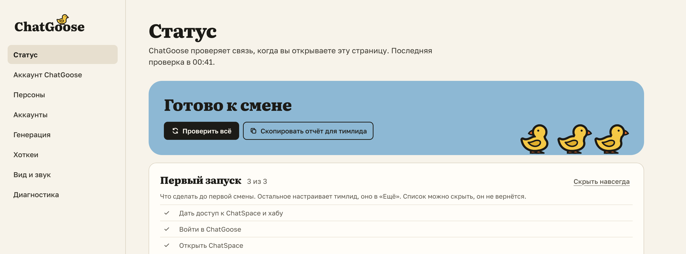

# Все настройки на одной странице и «Скачать лог»

Значок ChatGoose → «Настройки»: статус, аккаунт, персоны страниц, аккаунты, генерация, хоткеи, вид и звук,
диагностика. Если что-то не работает, начните со «Статуса»: там видно, всё ли на связи, и есть «Скопировать отчёт
для тимлида». Тема — как у сайта, как в системе, светлая или тёмная; текст панели — крупнее одним
переключателем.

Кнопка не нажимается, Hi не отправляется, ответ не вставляется — нажмите «Скачать лог» и отправьте файл
тимлиду.

## Как это устроено

Настройки хранятся в этом браузере и действуют на обоих сайтах. Каталог персон ведёт тимлид в хабе, а здесь вы
выбираете персону для своих страниц. В логе — записи за 24 часа со всех вкладок: нажатия, решения расширения и
ошибки, без текста переписки. Файл только скачивается и сам никуда не уходит.
