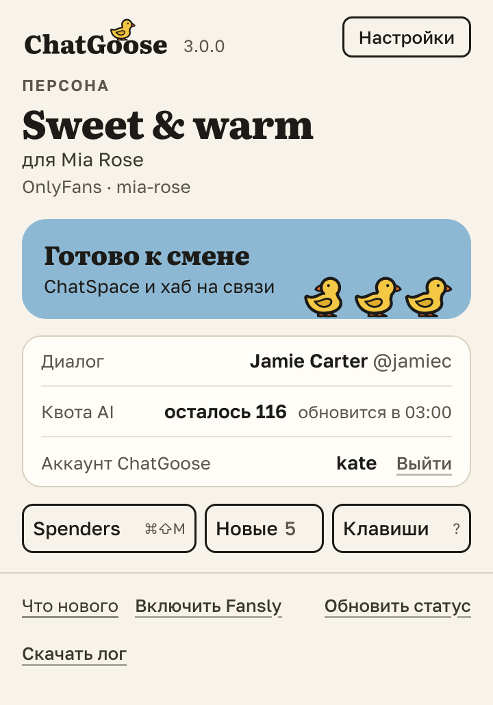
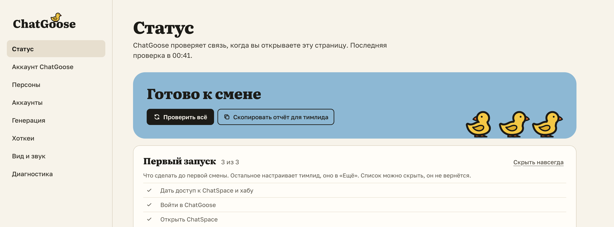

# «Скачать лог»: если кнопка не сработала, отправьте файл владельцу

Если кнопка не нажимается, Hi не отправляется или ответ не вставляется, нажмите значок ChatGoose на панели
Firefox, а внизу окна «Скачать лог», и отправьте файл владельцу. По нему видно, что вы нажимали, что решило расширение и
почему.

Всё ли на связи, видно в том же окне и в «Настройках» → «Статус».

## Как это устроено

В логе записи за 24 часа со всех вкладок: нажатия, решения расширения и ошибки, без текста переписки. Файл
только скачивается и сам никуда не уходит.
