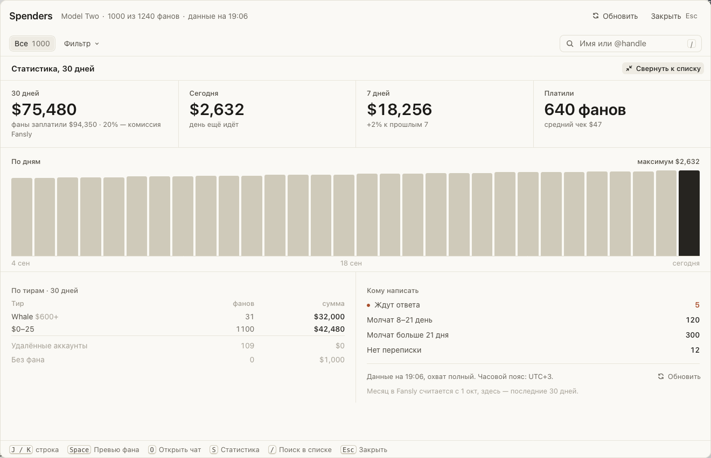
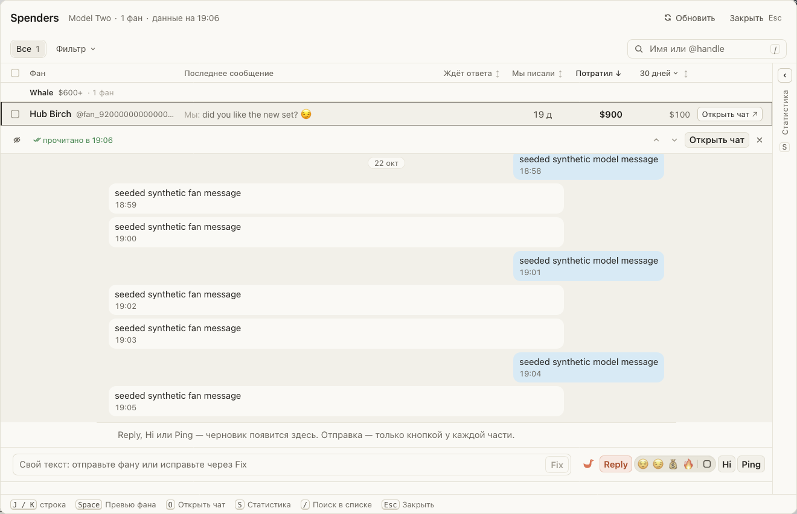

# Spenders: все платящие фаны, статистика и переписка под строкой

Для чаттеров Fansly. В Spenders все, кто когда-либо платил, по тирам: Whale, Top, Prime, Base, Low и
Micro. В строке фана — последнее сообщение, сколько он ждёт ответа и сколько потратил. Справа —
статистика страницы и «Кому написать»: кто ждёт ответа и кто давно молчит.

Нажмите на фана — переписка, Reply, Hi и Ping откроются прямо под строкой, ещё раз — свернутся. Клавиши:
J / K — по строкам, Space — переписка, O — открыть чат, S — статистика, / — поиск, Esc — закрыть.

## Как это устроено

Суммы и статистика приходят из хаба, в нетто модели — после комиссии Fansly. Если хаб ещё не догрузил
историю покупок страницы, сумма за всё время совпадает с суммой за 30 дней. Из переписки под строкой
ответ уходит только кнопкой у каждой его части: сам по себе ничего не отправляется.
