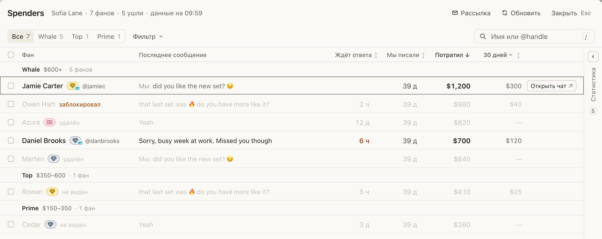
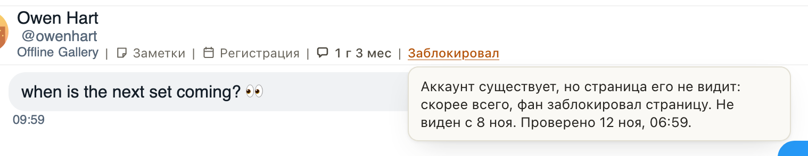

# Spenders говорит, кто удалил аккаунт, а кто заблокировал страницу

Для всех, кто работает со Spenders и «Рассылкой». Раньше про любого пропавшего фана было написано одно «удалён», и
не было понятно, удалил ли он аккаунт или заблокировал модель. Теперь вместо @ника видно, что случилось:

- «удалён»: аккаунта больше нет;
- «заблокировал» (на OnlyFans «в блоке»): аккаунт есть, но страница его не видит;
- «не виден»: страница перестала видеть фана, причина уточняется.

Наведите на пометку: она скажет, с какого дня фан не виден и когда это проверили. В шапке Spenders рядом с числом
фанов стоит «N ушли», а в «Фильтр» есть группа «Ушедшие»: показывать, скрыть или только они. На Fansly та же пометка
появляется в шапке открытого чата, рядом с «Заметки» и «Регистрация». В «Рассылке» условие называется «Без удалённых
и заблокировавших». Это только пометки: написать фану ничто не мешает.

## Как это устроено

Хаб раз в три дня проверяет каждого платившего фана через сессию страницы, а чат, который Fansly перестал отдавать,
проверяет за несколько минут. Если страница фана не видит, хаб выясняет причину: на Fansly отдельной проверкой без входа (аккаунт
удалён или существует), на OnlyFans по ответу самой страницы. Расширение замечает раньше: когда Fansly не вернул
аккаунт фана, показанного в Spenders, «Рассылке» или в открытом чате, строка сразу получает «не виден», хаб узнаёт об
этом и перепроверяет фана сам. Пока причина не названа, в «Рассылке» такой фан не исключается. Фан, которого страница
снова видит, теряет пометку сам. Расширение не делает для этого ни одного нового запроса к Fansly: оно использует
ответы, которые уже читает для значков и «Заметок».
