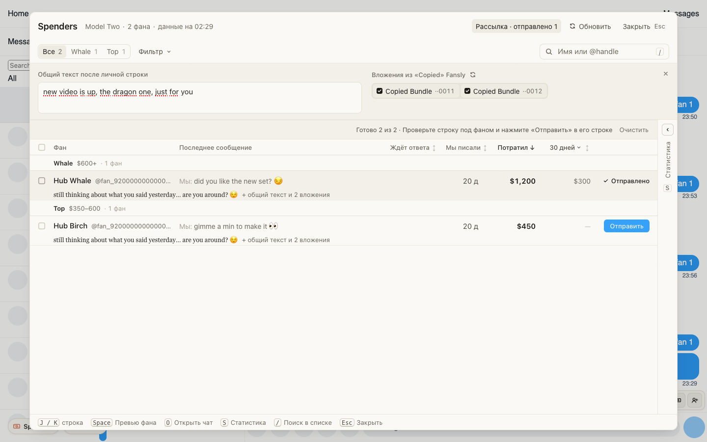

# Рассылка китам из Spenders: каждому своя первая строка и бандлы поста

Для чаттеров Fansly, когда новый PPV нужно предложить крупным фанам лично, а не массовой рассылкой.
Раньше каждому приходилось открывать чат, писать текст и дважды прикреплять Copied Bundle.

- В посте нажмите «Copy» у медиа: бандлы появятся в списке «Copied» Fansly.
- В Spenders нажмите «Рассылка» и напишите общий текст: что за видео. Скопированные бандлы уже отмечены.
- Отметьте фанов нужных тиров и нажмите «Написать личные строки»: под каждым появится его строка.
- Прочтите строку и нажмите «Отправить» справа в строке фана: уйдут строка, общий текст и бандлы.

Отправлять всем одной кнопкой нельзя: каждому фану свой клик.

## Как это устроено

Личную строку пишет хаб: это Reply тому, кто ждёт ответа, и Ping остальным, по переписке фана.
Бандлы ChatGoose берёт из того же списка, что и меню скрепки Fansly. Они уходят так же, как при
прикреплении вручную: цена и бесплатное превью уже заданы в бандле при выкладке поста.

Одно «Отправить» отправляет одно сообщение, с одной попыткой. Если ответ Fansly потерялся, строка покажет
«Неизвестно, ушло ли»: откройте чат и проверьте сами, повторно оно не уйдёт. Между отправками
полсекунды паузы.

После перезагрузки страницы Fansly сам показывает скопированные бандлы как «Copied Media»:
скопируйте бандлы в посте заново.
