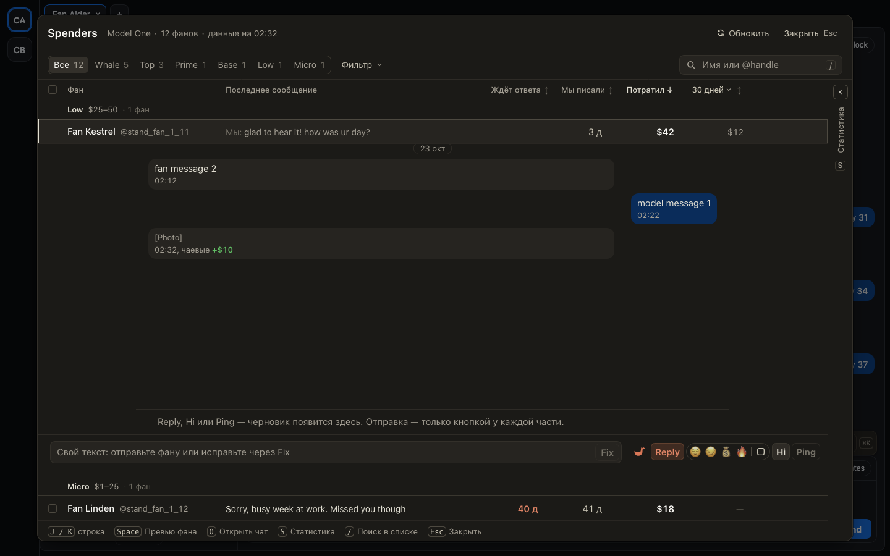

# Переписка под строкой Spenders сворачивается нажатием на фана

Для тех, кто листает Spenders с открытой перепиской фана.

- Нажмите на строку фана ещё раз, и переписка свернётся. Так же работает Space и строка фана, прилипшая
  сверху, когда вы пролистали переписку вниз.
- Колесо мыши над перепиской листает её, а у последнего сообщения продолжает листать список фанов. Раньше список
  стоял, пока курсор был над перепиской.
- Лента держит последнее сообщение на виду, даже когда черновик растёт на несколько строк.

## Как это устроено

Переписка под строкой устроена как строка того же списка, поэтому прокрутка, которой ленте уже некуда деваться,
передаётся списку. Поле черновика при росте больше не сжимается на миг до одной строки, и лента не
теряет своё место у последнего сообщения.
