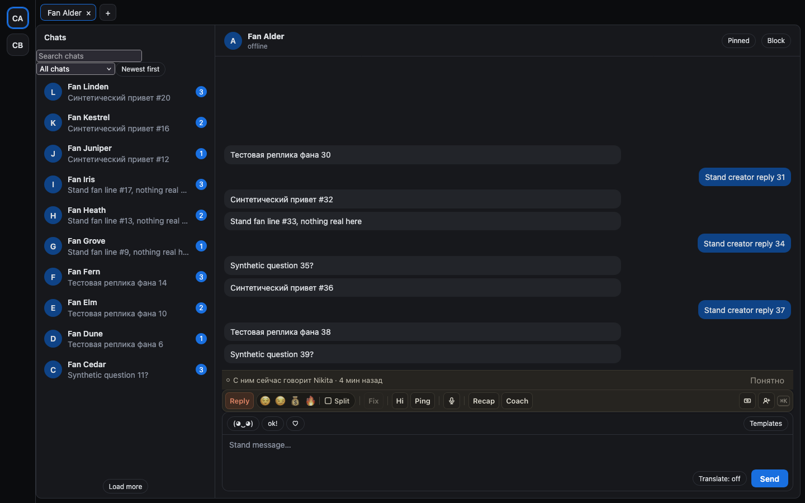
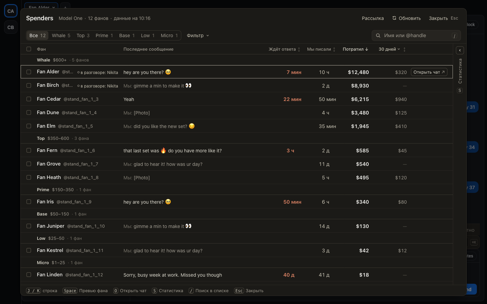

# Видно, кто из коллег сейчас говорит с фаном

Если другой чаттер писал фану последние 15 минут, в открытом чате над панелью ChatGoose появляется строка
«С ним сейчас говорит Никита · 4 мин назад». «Понятно» прячет её, пока коллега не напишет снова. В Spenders,
«Новых», ⌘K и быстром переходе у такого фана стоит пометка «в разговоре: Никита». Если отправить такому фану
ответ из превью, кнопка сначала предупредит, а «Отправить всё равно» отправит. Ничего не блокируется: фан
ничей, это подсказка, чтобы не перебивать коллегу и не продать одно и то же дважды.

Ещё расширение отмечает вашу смену: когда вы открыли сайт, работали и закрыли его. Это время ваших нажатий
и прокрутки, без того, что вы печатали.

## Как это устроено

Каждые 30 секунд расширение спрашивает хаб, кто писал фанам открытых страниц за последние 15 минут. Учитываются
только сообщения с автором, то есть отправленные из браузера с расширением. Пометка пропадает через 15 минут
тишины или когда коллега закрыл расширение. Ваши собственные сообщения пометку не ставят.

Смена: раз в минуту, пока открыта вкладка страницы, расширение сообщает хабу, какие страницы открыты и сколько
прошло с последнего нажатия, клика или прокрутки. Закрыли последнюю вкладку или вышли из аккаунта — смена
закрывается. Пауза начинается после 10 минут без действий. Содержимое страницы не передаётся.
