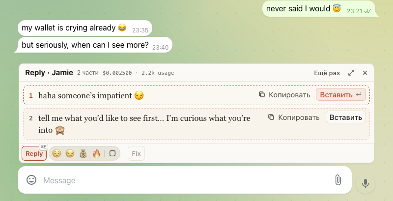

# Reply и Fix теперь работают в Telegram Лоры

Для тех, кто переписывается с фанами в Telegram Лоры. Под полем ввода в Telegram Web теперь та же панель, что на
Fansly: Reply с тонами пишет ответ её голосом на языке фана, Fix правит ваш текст прямо в поле. Отправляете, как
всегда, вы сами.

Как включить:
- Откройте меню ChatGoose и нажмите «Включить Telegram», разрешите доступ к сайту.
- Откройте web.telegram.org/a/ с аккаунтом Лоры (открытую вкладку перезагрузите).
- Откройте личный чат с фаном: панель появится над полем.

Панель работает только на аккаунте Лоры: в личном Telegram её нет. Когда ответ ложится в поле, фан видит
«печатает…», как при обычном наборе.

## Как это устроено

Расширение читает только открытый чат, ровно то, что Telegram показал на экране, и отправляет эту переписку на
генерацию по нажатию Reply или Fix. Других чатов оно не открывает и не прокручивает. Если чат прокручен вверх и
последних сообщений на экране нет, панель предупредит: прокрутите вниз и нажмите ещё раз. В Telegram своя
персона Лоры: она флиртует и общается, а продаёт только с тоном 💰 и никогда не называет цену и реквизиты. Fix
сохраняет ваши цифры, ссылки и реквизиты символ в символ. Работает только Telegram Web в Firefox, версия /a/.
