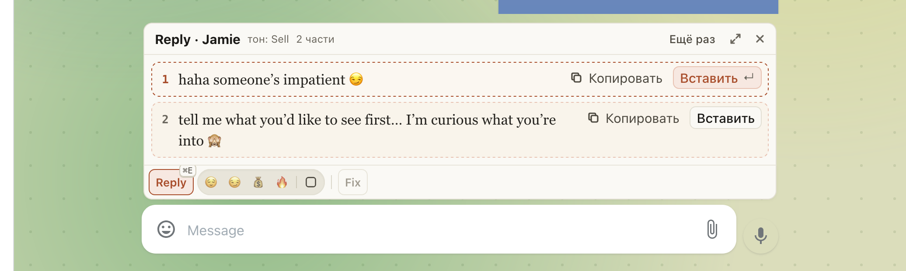

# Тон продажи работает в Telegram

В Telegram Reply с тоном 💰 Sell раньше завершался ошибкой вместо ответа. Теперь можно выбрать 💰 Sell
и нажать Reply: ответ появится над полем сообщения, как с остальными тонами.

## Как это устроено

Убрана устаревшая проверка расширения, которая отклоняла тон «Продажа» вместе с перепиской из Telegram ещё до
запроса к хабу. Хаб уже поддерживает этот тон. Ограничения на массовые сообщения и вложения в Telegram сохранены.
