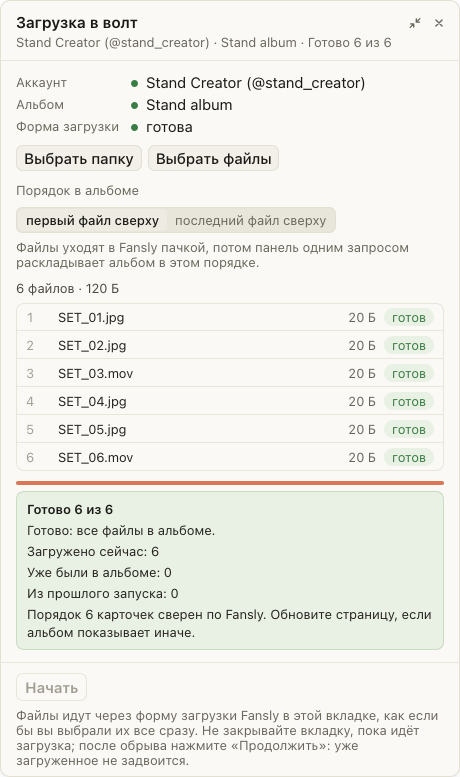

# Загрузка в волт идёт пачкой и сама ставит порядок в альбоме

Раньше «Загрузка» отдавала Fansly по одному файлу и ждала, пока он обработает каждое видео: пак на 4,5 ГБ шёл около
часа, и время от времени очередь вставала, пока кто-нибудь не дольёт файл руками. Теперь весь набор уходит в Fansly
сразу, а порядок в альбоме панель выставляет сама в конце. Тот же пак заливается за то время, пока уходят байты (на
хорошем интернете минут десять), и смотреть за ним не нужно. Если Fansly оставил файлу старое имя вроде IMG_0191,
панель сама переименует его по набору.

## Как это устроено

Файлы уходят в форму Fansly одним выбором, как если бы их выделили все сразу: страница грузит их параллельно.
Что легло в альбом, панель узнаёт у самого Fansly, а не по карточкам на странице. Затем одним запросом добавляет
набор в альбом заново в нужном порядке: повторное добавление не создаёт дублей, файл просто встаёт на своё место. Не
легший файл уходит ещё раз (те же байты Fansly узнаёт и не дублирует), после трёх раз панель скажет, какой файл не
загрузился. Карточки на странице покажут новый порядок после обновления.
