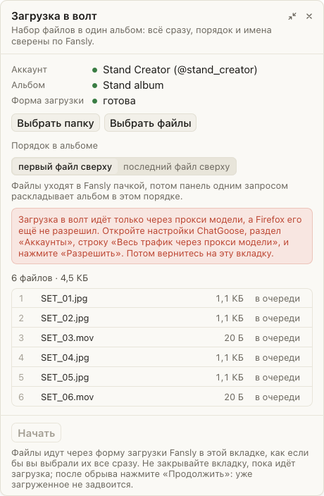

# «Загрузка» в волт начинается только через прокси модели

Раньше панель загрузки стартовала, даже если трафик вкладки шёл не через прокси модели: подсказку про прокси можно было закрыть кнопкой «Позже», а вкладка могла быть открыта вне контейнера модели. Тогда файлы и запросы к альбому уходили с вашего адреса. Теперь панель сначала проверяет, что вкладка открыта в контейнере модели и что ChatGoose ведёт её трафик через прокси этой модели. Пока это не так, кнопка «Начать» не нажимается, а панель пишет, что сделать: разрешить прокси в настройках ChatGoose («Аккаунты», «Весь трафик через прокси модели»), открыть Fansly в контейнере модели или написать администратору, если прокси для модели нет.

## Как это устроено

Перед каждым «Начать» панель спрашивает фон ChatGoose, ведёт ли его маршрутизатор трафик этой вкладки через прокси её модели. Проверки по порядку: Firefox дал разрешение на прокси; хаб прислал прокси вашего логина; вкладка открыта в контейнере Firefox; для модели этой вкладки в хабе есть прокси SOCKS5, и контейнер привязан к её странице. Ответ проверяется, когда панель открывается, когда вы возвращаетесь к ней и прямо перед каждым «Начать» и «Продолжить». Сами байты файла уходят в хранилище Fansly на Amazon S3. Маршрутизатор ChatGoose видит только адреса fansly.com, поэтому эти запросы вкладки ведёт прокси контейнера в Multi-Account Containers.
