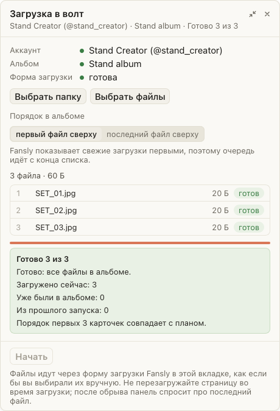

# Загрузка в волт продолжается, даже если Fansly вернул старое имя файла

Если Fansly показывал загруженный файл как IMG_… вместо имени из набора, очередь могла
зависнуть. Теперь загрузчик сам задаёт имя новой карточке внутри выбранного альбома,
проверяет результат и переходит к следующему файлу. Ручное переименование и обновление
страницы для этого больше не нужны.

## Как это устроено

После подтверждённого добавления и обновления альбома загрузчик распознаёт одну новую
карточку перед прежними и использует окно переименования Fansly. Меняется имя в этом
альбоме. Изменения текста карточки тоже отслеживаются. Обработка видео по-прежнему
дожидается завершения; если готовую карточку нельзя однозначно подтвердить или сохранить
её имя, очередь сообщает об этом через 30 секунд и не загружает файл повторно.
