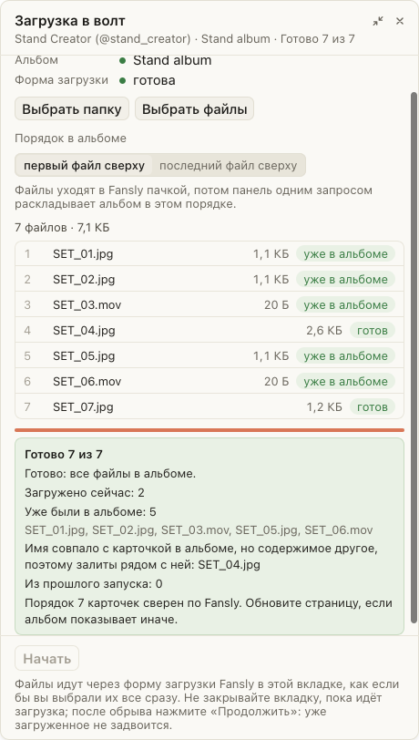

# «Загрузка» в волт заливает файл с тем же именем, если содержимое другое

Раньше панель считала файл уже залитым, если в альбоме была карточка с тем же именем. Переделанное фото под старым именем так и не попадало в альбом, а панель писала «Готово». Теперь панель сверяет с карточкой и содержимое: размер картинки, у видео ещё длительность. Файл с другим содержимым уходит в Fansly и встаёт рядом со старой карточкой, итог называет такие файлы. Файлы, которые панель посчитала уже залитыми, итог перечисляет по именам, чтобы их можно было проверить глазами.

Ещё три правки. Фото и видео одного Live Photo (IMG_1.JPG и IMG_1.MOV) панель больше не отклоняет как одинаковые имена. Файл, который не лёг с первого раза, она повторяет с паузой. Долгую обработку большого видео больше не принимает за зависание.

## Как это устроено

Fansly не отдаёт ни размер файла в байтах, ни его хэш: у карточки в ответе альбома есть тип (фото или видео), ширина и высота, у видео ещё длительность. Панель читает то же из заголовка самого файла (JPEG, PNG, GIF, WebP, MP4, MOV; весь файл не читается) и сравнивает. Совпали имя, размер картинки и длительность (с запасом в полсекунды): файл уже в альбоме. Два разных снимка одного телефона с одинаковым именем и размером так не различить, поэтому итог называет такие файлы. Если содержимое не прочитать (например, WebM), файл уходит в Fansly: те же байты Fansly узнаёт и отвечает старой карточкой, тогда файл считается уже бывшим в альбоме.

Какая карточка какому файлу принадлежит, панель узнаёт из ответа Fansly на загрузку: в нём имя и размер файла и номер медиа. Чужая карточка, появившаяся во время загрузки, ничьей не считается и не переименовывается. Переименование засчитывается, только если Fansly ответил новым именем, а в конце панель читает альбом и сверяет порядок и имена. Повтор идёт через 10 секунд, следующий через 30. Признаком работы страницы считаются и движение полоски прогресса, и ответы Fansly, пока он обрабатывает файл.
