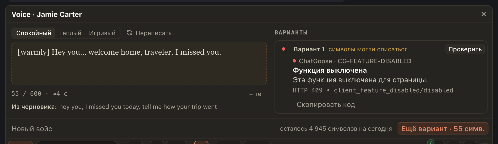

# Неудачная проверка войса сохраняет «Проверить»

Если после «Озвучить» ответ потерялся, а «Проверить» не смогло получить результат, вариант остаётся с пометкой «символы могли списаться». Раньше отказ проверки мог ошибочно показать «символы не потрачены» и убрать кнопку проверки.

Вы можете нажать «Проверить» снова, когда доступ восстановится. Сохранённый вариант остаётся защищён от очистки локальных данных, а «Новый войс» по-прежнему просит подтвердить его удаление.

## Как это устроено

Отказ повторной проверки не определяет, был ли оплачен исходный запрос. Расширение сохраняет неопределённый результат и исходный идентификатор дубля, пока хаб не вернёт запись этого запроса. Повторная проверка выполняется только по вашему нажатию, с тем же идентификатором. Автоматических повторов платного запроса нет.
