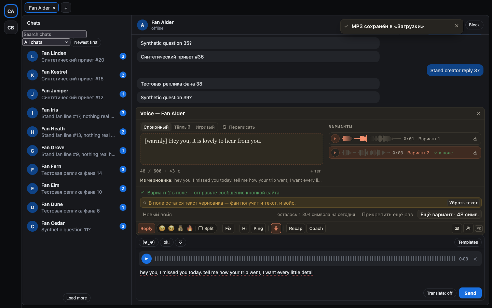
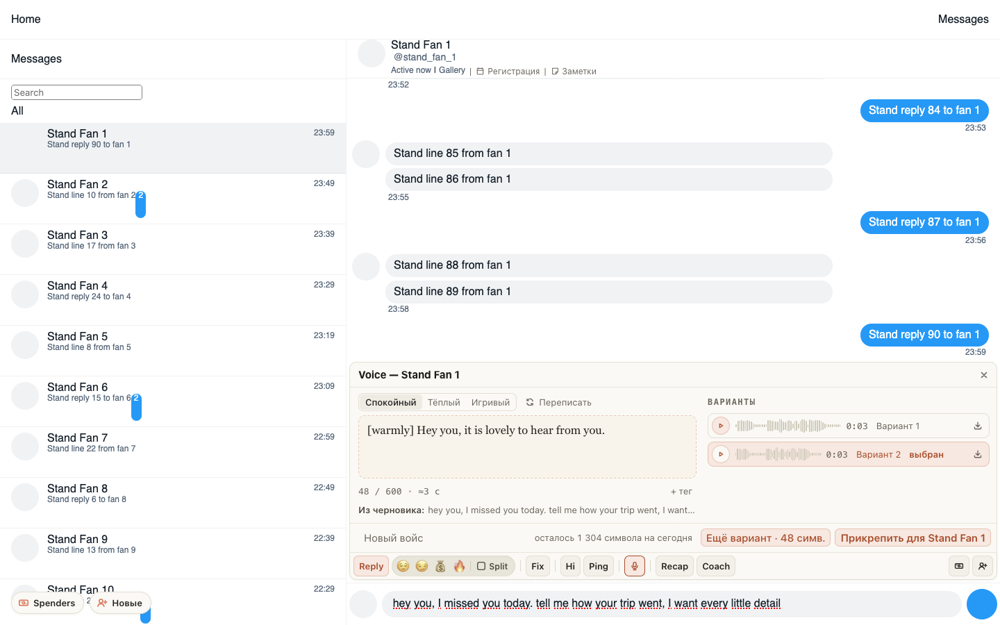

# Voice: голосовое голосом модели из вашего черновика

Кнопка 🎙 (Voice) в доке, сразу после Ping, делает из черновика голосовое сообщение голосом модели — в
ChatSpace и на Fansly. Напишите в поле, что сказать фану, и нажмите 🎙: сразу появится скрипт для озвучки. Его можно
поправить, сменить подачу (Спокойный, Тёплый, Игривый) или добавить интонацию через «+ тег» — шёпот,
смешок, вздох, паузу. «Озвучить» делает вариант: послушайте его прямо в доке, при желании сделайте
«Ещё вариант» и выберите лучший. «Прикрепить» кладёт войс в поле чата, отправляете вы — кнопкой сайта.
Текст черновика после этого остаётся в поле: «Убрать текст» уберёт его, чтобы фан получил только войс.
Над кнопками видно, сколько символов голоса у страницы осталось на сегодня; если скрипт длиннее
остатка или лимит исчерпан, строка становится жёлтой и говорит, когда он обновится.

## Как это устроено

Скрипт пишет AI по черновику и последним сообщениям чата — это бесплатно и не тратит символы.
Символы тратят только «Озвучить» и «Ещё вариант», сколько — написано на кнопке; лимит у страницы
дневной. Остаток считает хаб — меньшее из лимита страницы и общего лимита, день идёт по UTC; Voice
спрашивает его бесплатно, когда открывается и когда вариант озвучен. Это подсказка, а не запрет:
«Озвучить» нажимается всегда, а вариант сверх остатка хаб отклонит, ничего не списав. Счётчик под
скриптом считает до длины, которую хаб принимает сейчас. Ничего платного расширение не повторяет само: если ответ на озвучку потерялся, вариант
помечается «символы могли списаться», а «Проверить» спрашивает о нём ещё раз тем же запросом, без
повторной оплаты. Скрипт и варианты хранятся три дня и переживают перезагрузку вкладки и браузера.

Войс никогда не уходит сам. На Fansly он открывает обычное окно загрузки сайта — Free или PPV выбираете
вы; в ChatSpace ложится в поле как обычное аудио. Если сайт файл не принял, его можно скачать кнопкой
«Скачать MP3». Voice виден только на страницах, где владелец включил голос.
