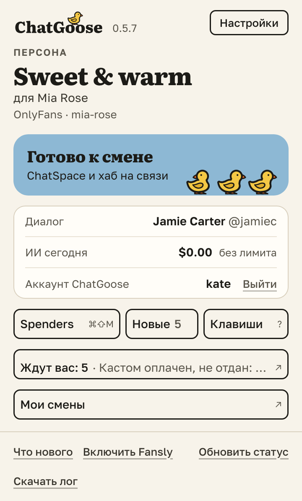
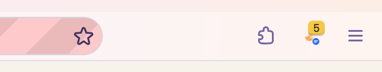

# Число на значке ChatGoose: сколько дел ждут вас в Workboard

На значке ChatGoose на панели браузера теперь видно число: столько дел ждут вас в Workboard (например, ответить
в «Обучалке» или отдать оплаченный кастом). Когда ничего не ждёт, числа нет. Оно обновляется само, пока открыта
вкладка ChatSpace или Fansly, и сразу, когда вы открываете окно расширения. Ни звука, ни всплывающих окон: можно
спокойно закончить разговор с фаном.

В окне расширения над «Мои смены» появилась строка «Ждут вас: 2» с самым давним делом. Нажмите на неё, и Workboard
откроется в новой вкладке, вход уже выполнен.

Если ваша последняя смена ещё не сдана, а сдача смены в Workboard у вас включена, кнопка «Мои смены» называется
«Сдать смену» и открывает отчёт этой смены.

Если не обращать внимания на число, ничего не потеряется: дела остаются в Workboard, пока их не сделают.

## Как это устроено

Число приходит в ответ на отметку активности, которую расширение и так раз в минуту отправляет в хаб, пока открыта
вкладка страницы: отдельных запросов по таймеру нет. Окно расширения при открытии спрашивает у хаба список дел
(до 50 самых давних, без подробностей) и обновляет число по тому же ответу. В число входят только ваши дела; дела
с деньгами и то, что только для сведения, не считаются. Больше 99 значок показывает как «99+». После выхода из
расширения или входа под другим аккаунтом число сразу пропадает.

«Ждут вас» открывает «Мои смены» в Workboard (список дел там же), «Сдать смену» открывает экран смены; обе входят
по одноразовой ссылке, как «Мои смены». «Сдать смену» появляется, только пока в хабе открыто дело «смена не сдана»:
оно открывается через два часа после конца смены и только при включённой сдаче смены в системе, а после сдачи
кнопка снова становится «Мои смены». Если хаб не прислал число (старая версия или не смог посчитать), значок
остаётся как был. Новых разрешений расширение не просит.
