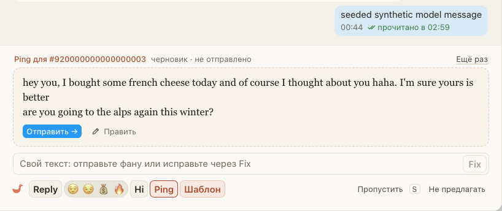

# Ping в окнах «Онлайн» и «Очереди» пишет так же, как в чате, с вопросом

Ping в окне «Онлайн» или «Очереди» иногда выходил без вопроса, хотя тот же Ping в чате спрашивал фана о чём-то.
Модель часто пишет Ping в два сообщения, и вопрос стоит во втором. Чат показывает обе части, а окно брало
только первую. Теперь в окне весь текст Ping одним сообщением: вторая часть идёт с новой строки. То же для
Reply и Hi в этих окнах и для версий «Рассылки».

## Как это устроено

Окно отправляет фану одно сообщение, поэтому раньше из ответа модели на кнопку оставалась первая часть,
а остальные терялись. Теперь окно просит ответ одним текстом, и расширение склеивает все части через перенос
строки, ничего не отбрасывая. В чате части остаются отдельными сообщениями, как и были.
